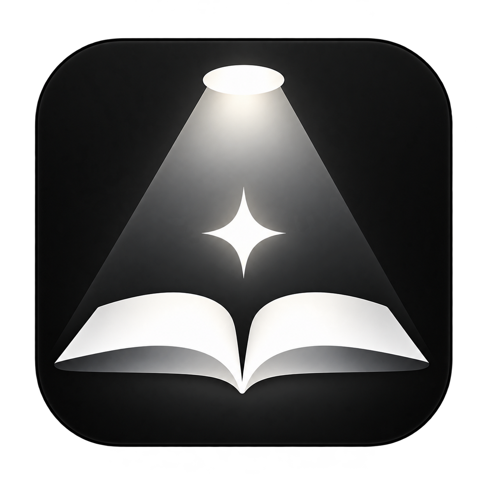
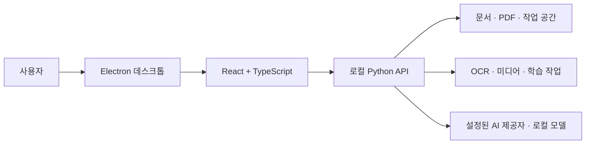

<p align="center">
  
</p>

<h1 align="center">AILS Desktop</h1>

<p align="center"><strong>자료를 읽고, 정리하고, 연습하는 과정을 한 곳에 연결하는 학습 작업 공간</strong></p>

AILS는 Windows 데스크톱에서 PDF와 문서, 강의 자료, 코드 실습과 AI 학습 보조 기능을 함께 다루는 프로젝트입니다. 자료를 열어 읽는 화면과 질문·요약·문제 풀이의 흐름을 연결해, 학습 중 필요한 작업을 여러 도구 사이에서 반복하지 않도록 설계했습니다.

> 현재 저장소는 개발자판 소스입니다. 외부 AI 기능은 별도 계정 연결과 사용자 동의가 필요할 수 있으며, 일부 OCR·미디어 기능은 추가 런타임이나 모델이 필요합니다.

## 주요 기능

| 영역 | 제공하는 작업 |
| --- | --- |
| 자료 작업 공간 | 폴더와 파일 탐색, 탭 기반 문서 열기, 자료 검색과 정리 |
| 문서·PDF | PDF 보기와 주석·북마크, OCR, 문서 열기 및 편집 워크플로우 |
| AI 학습 보조 | 자료를 바탕으로 한 질문, 요약과 문제 생성·풀이 |
| 영상·음성 | 영상과 음성 입력을 이용한 정리 및 전사 워크플로우 |
| 코드 학습 | 코드 작업 공간, 노트북 및 실행 환경 연결 |
| 학습 기록 | 학습 문서와 문제 풀이 기록을 이어서 확인 |

기능의 실제 사용 가능 여부는 설치 환경, 선택한 모델·제공자 및 연결 상태에 따라 달라집니다.

## 기술 구성

| 계층 | 기술과 역할 |
| --- | --- |
| 데스크톱 | Electron, Windows 설치·창·IPC·업데이트 |
| 화면 | React, TypeScript, Vite, Tailwind CSS |
| 로컬 서비스 | Python API, 파일·문서 처리와 작업 관리 |
| 문서·학습 | PDF.js, PDF OCR, Markdown, Office·노트북 연동 |
| AI·미디어 | 외부 AI 연결, 로컬 모델 런타임, OCR·음성 및 미디어 처리 |



## 구현에서 다룬 문제

- **작업의 경계:** Electron은 창과 프로세스 수명을 관리하고, React는 화면과 사용자 상호작용을, Python 서비스는 파일과 장시간 작업을 담당합니다. 기능별 상태와 서비스 경계는 [애플리케이션 구조](docs/features/application-architecture.md)에 정리했습니다.
- **안정적인 문서 작업:** 문서 저장을 순서대로 처리하고, 늦게 도착한 요청이 다른 문서의 상태를 덮어쓰지 않도록 작업 수명을 관리합니다.
- **설치와 업데이트:** 새 버전을 준비·검증한 뒤 전환하는 업데이트 흐름과 실패 후 복구 경로를 분리했습니다. 자세한 내용은 [업데이트 복구](docs/features/update-recovery.md)를 참고하세요.
- **외부 서비스와 로컬 환경:** AI 연결 및 외부 전송 동의, 로컬 API 인증과 개발자 계정 동작을 구분합니다. 개발자판 계정 동작은 [개발 모드 설명](docs/features/serverless-developer-mode.md)에 정리했습니다.

## 개발 환경

Windows에서 64비트 Python 3.12와 Node.js를 준비한 뒤 의존성을 설치하고 개발 실행기를 사용합니다. 설치 명령, 런타임 조건과 알려진 제약은 [개발환경설정.md](개발환경설정.md)를 참고하세요.

```powershell
.\scripts\dev\dev_run_electron.bat
```

## 저장소 구성

```text
ails-frontend/   Electron과 React 화면
ails-backend/    로컬 Python API와 기능 서비스
bootstrap/       Windows 설치 보조 프로그램
scripts/         개발 실행 및 릴리스 도구
docs/            기능·구조 문서
licenses/        라이선스와 고지 자료
```

## 라이선스와 출처

이 저장소의 프로젝트 고유 코드에 적용할 별도 라이선스는 현재 명시되어 있지 않습니다. 서드파티 구성요소의 라이선스·고지 원문과 출처는 [licenses](licenses/README.md)에서 확인할 수 있습니다. 사용·재배포 전 각 구성요소와 실제 배포물에 포함된 의존성의 조건을 확인해야 합니다.
