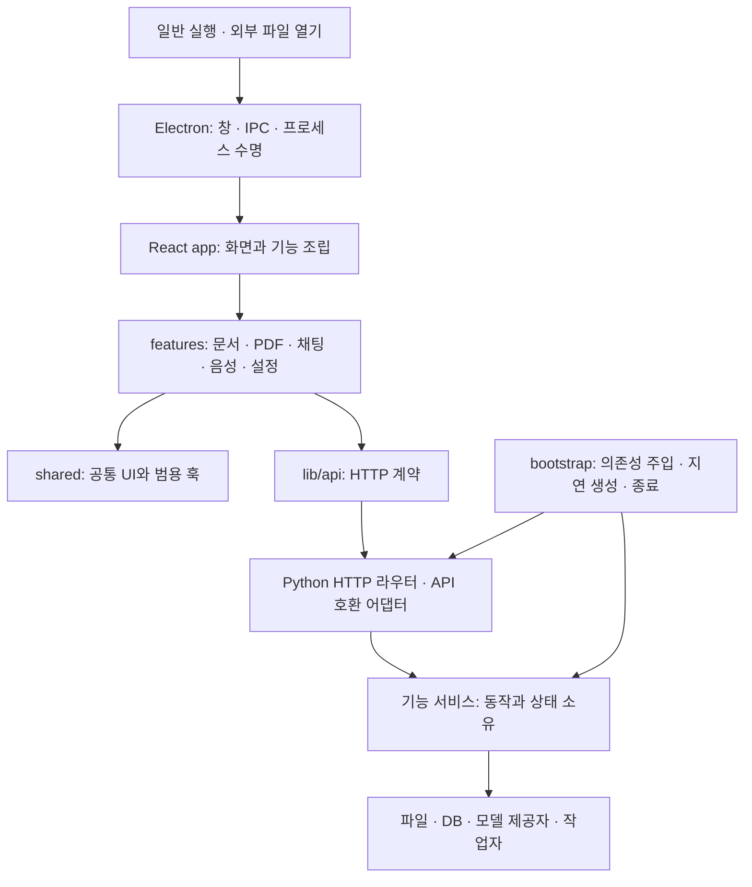

# AILS 애플리케이션 구조

AILS는 Electron 창, React 화면, 로컬 Python 서비스로 구성된다. 기능마다
상태와 작업의 소유자를 두고, 앱 조립 계층에서 의존성과 수명을 연결한다.
외부 파일 열기와 일반 실행은 같은 AILS 화면·문서 기능을 사용한다.

## 프런트엔드

- `App.tsx`는 기능 연결과 화면 구성을 담당한다. 문서 복원·파일 탐색·외부
  기능 활성화의 효과는 각각 담당 훅에서 관리한다.
- `app/workspaces`는 채팅과 음성처럼 여러 기능을 연결한다. 기능 내부 상태는
  `features`가 생성하며, 조립 계층은 공개 동작을 전달한다.
- PDF 컨트롤러는 문서·보기·주석·OCR·학습·번역 상태를 조합한다. 채팅
  컨트롤러는 메시지·입력·표시·학습 세션·보조 기능 상태를 조합한다.
- 문서 저장은 `DocumentSaveQueue`로 순서를 유지하고, 창 종료 전에 마지막
  저장까지 기다린다. 오래 걸린 이전 응답은 다른 문서의 상태를 덮어쓰지 않는다.
- `app/startup/PreparationQueue`는 선택 기능을 순서대로 준비한다. 한 기능의
  실패가 다음 기능을 막지 않으며, 화면이 종료되면 대기 중인 준비를 취소한다.
  화면 코드 준비 자체가 모델 실행이나 유료 AI 호출을 시작하지 않는다.
- `shared`는 `features`와 `app`을 가져오지 않는다. 기능은 앱 조립 계층을
  역참조하지 않으며, 다른 기능에서는 `feature-contracts.json`에 명시한 모듈과
  심볼만 사용한다. 타입 계약은 `import type`으로 참조한다. AST 기반
  `scripts/check-architecture.mjs`가 정적·동적 import와 재수출을 검사한다.

## 백엔드

`api_server.py`는 실행·기존 import 호환 진입점이다. `bootstrap/application.py`의
`ApiState`는 설정과 앱 자원을 연결하는 공개 facade이고, `api_modules`는 기존
메서드 서명과 HTTP 호출 경로를 유지하는 위임 어댑터다.

`bootstrap/services.py`가 각 서비스에 필요한 이름 있는 콜백과 조회 함수만
전달한다. 서비스에는 전체 `ApiState`나 서비스 레지스트리를 넘기지 않는다.
기능 서비스와 지원 모듈은 `api_modules`, `api_server`, `bootstrap`을 import하지
않는다. 설정은 하나의 `Configuration`에서 조회하므로 설정 교체 후에도
오래된 사본을 붙잡지 않는다.

| 영역 | 서비스 책임 |
| --- | --- |
| `chat` | 대화, 메모리, 조사 도구 |
| `documents` | 자료 작업공간, 학습 기록, 연습 문제, 검수, 자동 검수, Insight, 한글 편집기 서버 |
| `pdf` | 뷰어 데이터, OCR·번역 등 PDF 작업 |
| `search` | 자료 검색 요청 |
| `accounts` | 관리형 인증과 세션 |
| `settings` | 모델 선택과 옵션 |
| `lms` | 브라우저 세션, 강좌 |
| `jobs` | 요약 작업, 작업 전 점검 |
| `summary_generation` | 영상 AI 처리 |
| `voice` | 음성 에이전트 |
| `code_services` | 노트북 커널, 코드 보조 |

24개 서비스는 첫 사용 시 한 번 생성한다. 상태는 해당 서비스 인스턴스가
소유한다. 이전 API 필드에 대한 호환 접근도 같은 인스턴스로 연결되며, 상태를
복제하지 않는다. `*_support.py`에는 해당 기능의 기존 정책·변환·제공자 헬퍼가
있다. 기존 함수의 import 경로는 API 호환 모듈에서 유지한다.

`OfficeStudioRuntime`은 한글 편집기의 로컬 HTTP 서버와 스레드를 앱별로
소유한다. 편집기 첫 요청 때만 생성하고, 앱 종료 시 포트와 스레드를 함께
해제한다. 동시에 요청해도 서버는 하나이며 종료 중이나 종료 후에는 새 서버를
만들지 않는다. 리소스 무결성 검사와 별도 출처·Host·CSP 정책은 유지한다.

큰 서비스 내부의 책임도 다음과 같이 나눈다. 각 구성요소에는 필요한 콜백만
담은 Ports를 전달하며, 호환 필드도 구성요소의 같은 상태를 읽고 쓴다.

| 공개 서비스 | 내부 소유자 |
| --- | --- |
| 대화 | 요청 준비·턴 캐시, 응답 생성, 답변 문서 저장 |
| 자료 작업공간 | 자료 목록·캐시, 파일 작업, 연습 문제 생성·취소 |
| 자동 검수 | 작업·스레드·취소, 로컬 검수, 멀티모달 검수, 검수 기록 |

`EmbeddingRuntime`은 애플리케이션마다 하나씩 생성한다. 모델 캐시, 인덱싱
큐·스레드, 준비 스레드, 유휴 타이머와 취소 이벤트를 소유한다. 요청 컨텍스트는
소유자를 전달할 뿐 자원을 생성하지 않는다. 메모리 검색도 이 소유자로부터
모델을 빌리며, 폐기된 모델을 계속 보관하지 않는다. 네이티브 추론은 별도
프로세스에서 실행하여 진행 중에도 취소할 수 있다. 취소 뒤 다른 요청은 모델을
다시 만들 수 있지만 앱 종료 뒤에는 재생성하지 않는다. 모델이 바뀌면 이전
모델의 벡터와 섞지 않고 해당 요청을 실패시킨다.

`BackgroundDocumentWorkManager`도 `background_documents` 지연 서비스로
앱이 소유한다. 설정의 불리언 정규화는 `settings/value_coercion.py`에 두어
설정을 읽기 위해 작업 관리자와 그 의존성을 import하지 않는다. 앱 생성·기본
상태 확인·Markdown 읽기와 미사용 앱 종료에서는 작업 원장을 읽지 않는다.
자료 스캔 준비 또는 실제 기능 요청이 관리자를 처음 만들며, 기존 복구 스캔은
그 시점에 저장된 작업을 이어서 진행한다. 번역·OCR 완료 콜백도 서비스 생성 시
주입하고, 종료 중에는 미사용 관리자를 만들지 않으며 사용한 관리자만 멈춘다.

작업 원장은 명시된 `AILS_RUNTIME_DATA_DIR` 아래의 `background/document_work.json`을
사용한다. 이 값이 없으면 기존 사용자 경로를 유지한다. 이전에는 명시된 런타임
경로가 작업 원장에 적용되지 않았으며, 현재 격리 검사와 냉간 실행 전후에는
실제 사용자 원장의 해시가 변하지 않았음을 확인했다.

`scripts/check_backend_architecture.py`는 루트 도메인 모듈을 포함해 Python
구문과 import를 검사한다. API 어댑터·bootstrap 밖에서 API·조립 계층을
참조하면 실패한다. `npm run check:architecture`와 프런트엔드 `lint`에 두
구조 검사를 연결했다.

## 시작과 종료

Electron은 로컬 백엔드와 화면을 준비하며 외부 파일 요청을 기존 창으로
전달한다. 외부 파일 실행에서는 첫 화면 이후 상태·자료 목록·옵션·화면 코드
등을 순차 준비한다. PDF는 같은 뷰어의 모듈과 PDF.js 작업자를 미리 준비하고,
각 문서가 작업자 사용권을 반환하면 유휴 상태에서 해제한다. 별도 경량 창을
띄우거나 준비 완료 후 다른 창으로 교체하지 않는다.

개발 실행기는 `backend-host.cjs`가 Python 모듈 import를 Electron 시작과
겹쳐 실행한다. 이 단계에서는 앱 상태와 HTTP 서버를 만들지 않는다.
단일 인스턴스 잠금을 얻은 Electron이 상속된 Node IPC로 포트·출처·인증
토큰·외부 문서 권한을 전달하면, 실행기가 Python의 비공개 표준입력에 시작
메시지를 보낸다. `bootstrap/desktop_handshake.py`가 길이·인수·환경 키를
검증한 뒤 기존 `main()`으로 진입한다. Python 도메인 로직이나 HTTP 경로를
Electron에 복제하지 않으며 직접 Electron 실행과 패키지 실행 경로도 유지한다.
두 번째 파일 실행기의 사용하지 않은 Python은 실행기 종료 때 닫는다.

정적 게이트웨이는 창을 만들기 전에 빌드 경로와 작은 캐시 허용 목록만 동기
조회한다. 첫 비동기 파일 조회의 대기를 백엔드 실행 앞에 두지 않으며 실제
정적 파일·문서 응답은 비동기 스트림을 유지한다. 진단 기록은 main import,
IPC 등록, 포트 선택과 게이트웨이 준비를 구분한다. 동일 환경의 관찰에서 포트
선택 이후 게이트웨이 준비는 약 58ms에서 3ms로 줄었다. 이 구간의 개선이
전체 문서 표시 시간의 동일한 감소를 보장하지는 않는다.

프런트엔드 빌드는 작업공간의 정적 의존성을 한 묶음으로 만들고, 초기 진입점과
문서 읽기 API는 별도 묶음으로 유지한다. 첫 문서 읽기와 PDF 작업자 시작은
작업공간 평가를 기다리지 않으며 선택 편집기의 동적 import 경계도 유지한다.
실제 CSV의 첫 표시까지 JavaScript 요청이 62개에서 11개로 줄었다. PDF의
입력창, CSV·XLSX 첫 검색, 편집기 한 번 생성과 정상 종료를 확인했고 PDF에서
시트 엔진, 시트에서 PDF·DOCX·Monaco 엔진이 먼저 로드되지 않음을 확인했다.
지연된 홈의 첫 표시와 CSV 탭 복귀에서도 같은 캔버스와 편집기를 유지했다.

홈 자료 대시보드는 별도 지연 모듈이다. 외부 파일 요청을 처리하는 동안
기존 문서 로딩 화면을 표시하고 홈 대시보드를 먼저 만들지 않는다. 문서 본문이
표시되면 준비 큐가 홈과 나머지 화면 코드를 자동으로 불러온다. 최초 요청이
실패하면 홈을 사용할 수 있도록 대기를 해제한다. 일반 실행은 홈 코드를 바로
준비하며, 홈과 문서를 오갈 때 이미 만든 홈 화면의 상태를 유지한다.

요약 생성·계정 대화상자의 표시 코드는 별도 모듈로 불러온다. 닫힌 상태에서는
문서 시작 경로에 포함하지 않으며, 작업·계정 상태는 기존 컨트롤러가 계속
소유한다. 설정을 열 때는 계정 화면 코드도 함께 준비한 뒤 설정을 마운트한다.
설정의 동시 API 조회 뒤에 계정 모듈 요청이 대기하여 첫 로그인 창이 준비
상태에 머무는 것을 피하기 위한 순서다. 실제 Electron에서 요약 입력값의
닫기·재열기 보존, 계정 탭 전환과 재열기 시 비밀번호 초기화, 각 모듈의 단일
다운로드와 정상 종료를 확인했다. 이 분리로 workspace-entry JavaScript는
841,266바이트에서 783,633바이트가 되었으나 전체 시작 시간 감소를 입증하지는
않는다.

PDF·노트북·Office의 선행 로딩은 지연 컴포넌트의 `preload()`를 사용한다.
모듈 캐시만 따로 채우는 대신 표시 컴포넌트와 준비 Promise를 공유하므로,
이미 준비된 화면은 첫 렌더에서 추가 준비 화면·effect commit 없이 사용한다.
준비 자체는 편집기를 생성하지 않으며, 실패한 준비는 재시도할 수 있다.
닫힌 학습챗봇 입력창은 draft·입력 컨트롤러를 유지하되 높이·너비 측정과
ResizeObserver를 열릴 때 시작한다. 실제 PDF에서 첫 입력, 여러 줄 입력과
펼치기, 창 크기 변경·축소, Escape와 재열기를 확인했다. 선행 로딩 변경 후
CSV·XLSX의 단일 편집기 생성과 첫 검색 `1/1`, 정상 종료도 확인했다.
같은 빌드에서 준비 결과 공유만 바꾼 비교는 실행 간 변동이 커 총시간 개선을
입증하지 못했으며, 이 구조 변경을 1초 목표 달성 근거로 사용하지 않는다.

퀵챗의 선택 확인은 커서만 있는 `Selection.isCollapsed` 상태에서는 문자열을
읽지 않는다. 입력란·시트 검색창 등에 포커스가 있거나 연결된 읽기 영역이 없으면
자동 포커스 판단도 일찍 끝낸다. 실제 텍스트 범위는 여전히 문자열을 확인하므로
그림만 선택한 범위와 구분한다. 실제 PDF 텍스트 선택·Ctrl+C, 선택 해제 뒤
퀵챗 입력, Escape·재열기와 한글 textarea 값 보존을 확인했다. 네이티브 IME
조합 입력까지 검증한 결과는 아니다. 선택 확인의 프로파일 비용을 줄이는 것과
전체 첫 표시 시간 개선은 구분하며, 현재 비교로 전체 시간 개선은 입증하지 못했다.

외부 PDF는 PDF.js 화면 모듈을 평가하기 전 모듈 작업자를 시작한다. 준비된
포트는 기존 뷰어가 한 번 인수하며, 시작 실패·페이지 종료·미사용 만료 시
해제한다. PDF.js 준비 신호를 받은 뒤 문서를 전달하고 일반 실행 경로는
기존 작업자 생성 방식을 유지한다. 빌드가 기록한 해시 포함 정적 자산만
장기 캐시하며 HTML 진입점, public 파일과 API 데이터에는 적용하지 않는다.

외부 노트북·Office 파일도 선택한 형식의 기존 화면과 편집기 코드만 미리
불러온다. Office의 파일 읽기와 편집기 모듈 로딩은 병렬로 진행한다. XLSX는
시트 엔진과 변환기를 동시에 준비하며 CSV 시작에서는 변환기를 제외한다. 노트북과 Office
화면은 PDF·Markdown과 같은 지연 컴포넌트로 연결하여 Suspense의 추가 표시
대기를 피하고, 가져오기 실패 시 재시도와 숨겨진 편집 상태 보존을 유지한다.

CSV·XLSX의 `sheets-ui-controller.ts`는 Univer 1.1의 UI 컨트롤러를 해당 편집기
인스턴스에서만 교체한다. 라이브러리의 고정 300ms 대기 대신 준비 단계와
콘텐츠 영역의 실제 크기를 확인하여 기존 캔버스를 연결한다. 메뉴·플러그인·
수식 엔진은 유지한다. 숨겨진 화면은 크기 변경을 기다리고, 종료 시 관찰자·
프레임 예약·구독을 해제한다. 라이브러리 버전을 바꿀 때 이 연결 계층과 숨김·
표시·편집·종료를 재검증해야 한다. 설치된 node_modules 자체는 수정하지 않는다.

`sheets-menu-manager.ts`는 같은 편집기 인스턴스의 메뉴 변경 알림을 소유한다.
메뉴 데이터는 즉시 병합하며 재귀 병합과 Rendered 단계의 플러그인 등록이 끝날
때 최종 알림을 한 번 동기적으로 보낸다. 중간 메뉴마다 전체 도구 모음과 구독을
다시 만드는 비용을 줄이며 타이머나 별도 작업 큐를 추가하지 않는다.
검색 제공자는 기본 Steady 대기(3초) 전에도 검색 명령에서 즉시 준비한다.
AILS 도구 모음의 검색·실행 취소·다시 실행은 해당 통합 문서를 명시적으로 지정한다.

시트 표시 진단은 두 프레임 이후 드러난 실제 시트 캔버스를 확인한다. 내부
텍스트 편집용 숨겨진 캔버스와 빈 편집기 컨테이너는 성공으로 기록하지 않는다.
파일 읽기·엔진 코드·파싱·플러그인·작업공간·캔버스 연결의 진단 시점도 구분한다.
Office 본문 읽기도 화면 마운트 전에 인증된 `GET /api/office/open`으로 시작한다.
읽기 요청은 게이트웨이에서 백엔드 준비를 기다리며 POST 저장·실행을 재생하지
않는다. Python의 기존 파일 허용·크기·형식 검사를 그대로 거치고 응답은
`no-store`로 전송한다. 읽기만으로 복구 폴더를 만들지 않으며 구형 POST 열기
경로도 유지한다.
준비된 값은 같은 파일을 여는 첫 편집기에만 전달하며, 다음 열기는 다시 읽는다.
닫힌 화면의 요청은 취소하고 실패한 준비 값은 재시도를 막지 않는다.

외부 파일의 최초 읽기는 화면 코드 준비와 겹쳐 시작한다. 준비된 요청은 같은
경로의 첫 소비자에게 한 번만 전달하고, 취소·교체·만료 시 해제한다. 정상 문서
읽기의 영구 캐시로 사용하지 않는다. 자료 작업공간은 읽기·저장, 목록·캐시,
파일 관리, 문제 생성의 소유자를 각각 첫 사용 시 한 번 만든다. 단순 읽기가
목록·이동·휴지통 처리 코드를 불러오지 않으며, 파일 관리도 같은 읽기·저장
인스턴스를 사용한다. 생성은 잠금으로 직렬화하고 종료 뒤 새 생성을 거절한다.
사용하지 않은 하위 서비스를 종료 과정에서 새로 만들지 않는다.

최초 문서의 본문이 표시될 때까지 이전 탭 복원, 채팅 이력·보조 상태, 인접
자료, PDF 주석·북마크·학습 세션과 문제 목록 조회를 늦춘다. 표시 관찰은 진단 기능을 끈 상태에서도
동작하며, 실패한 문서 때문에 준비가 계속 멈추지 않도록 대기 시간에 상한을
둔다. 최초 읽기만 게이트웨이에 먼저 전달하고 일반 요청은 백엔드 준비 확인을
유지한다. TXT는 PDF 처리로 보내지 않고 일반 텍스트로 안전하게 표시한다.

Python의 요약 엔진 자체도 필요할 때 생성하고, 작업을 넣을 때 작업자와
네트워크 감시를 시작한다. HTTP 준비 확인은 `/api/health`를 사용하여 상태
조회 때문에 기능 서비스를 만들지 않는다. 설정의 프롬프트 이관과 공급자
이름 변환은 미디어 처리 모듈과 분리되어 있다. HTTP 라우터는 OCR·음성·번역
모듈을 해당 요청 분기에서 참조한다. 설정의 로컬 LLM 선택 규칙은 카탈로그에서
읽고 실행 모듈을 만들지 않는다. 음성 인식 설정 등 구형 공통 모듈을 통해
시작 시 불러오는 의존성은 일부 남아 있다.
PDF 텍스트 추출과 슬라이드 변환 완료는 임베딩 모델을 직접 실행하지 않는다.
선택한 백그라운드 설정에 따라 문서 작업 관리자에 알리고, 관리자에서 준비
작업을 예약한다. 종료 뒤 도착한 알림이 작업자를 다시 시작할 수 없다.

종료 시 React 저장 가드가 먼저 완료된다. Electron은 상속된 표준입력 파이프로
백엔드에 종료를 전달한다. 개발 실행기 경로에서는 Electron의 종료 요청을
실행기가 중계하고 자신이 생성한 Python 프로세스 트리를 끝까지 소유한다.
재시도는 이전 백엔드 종료 후 시작한다. 부모가 비정상 종료되어도 파이프 EOF로
미사용 preload와 실행 중인 서버를 종료한다. `ApplicationLifetime`은 시작 복구, 요약 작업,
백그라운드 문서 작업, 사용된 기능의 자원, 레지스트리를 순서대로 닫는다.
사용하지 않은 기능을 종료 때문에 새로 만들지 않는다. 노트북 소켓과 커널은
생성한 작업자 스레드에서 정리한다. 종료는 반복 호출해도 안전해야 한다.
네이티브 작업이 멈춰 정상 종료 기한을 넘긴 경우 해당 실행 경로의 소유자가 백엔드
프로세스 트리를 종료한다.

OCR은 제공자에 관계없이 폐기 가능한 작업자 프로세스에서 실행한다. 종료는
작업 잠금보다 먼저 취소를 알리고 큐·프로세스를 정리한다. LLM 스트리밍은
프로세스 상태 잠금과 세션 잠금을 분리하여 스트림 소비 중에도 종료할 수 있다.

## 변경할 때의 기준

새 상태는 기능 소유자에 추가하고, 새 기능 간 의존성은 공개 동작으로 연결한다.
범용 UI에 기능을 연결하거나 서비스에서 HTTP·앱 조립 계층을 역참조하지 않는다.
새로 생성하는 작업자·프로세스에는 취소와 종료 경로를 함께 둔다.

API 서명과 응답, 저장 파일·DB 형식, 외부 파일 접근 허용 규칙은 유지한다.
검증은 격리된 데이터에서 서비스 동시 초기화·저장·취소·종료를 확인하고,
실제 Electron에서 외부 PDF·Markdown 열기, 기존 창 재사용, 편집·종료 저장을
확인한다. 유료 AI·실계정·패키징 검증은 이 로컬 구조 검증과 별도다.

## 검증 범위와 남은 목표

- 백엔드 77개 검사: 기존 API 서명, 서비스 경계·동시 생성, 설정·상태 소유,
  문서 저장·외부 경로 정책, PDF 학습 세션, 검색 선택, 취소·종료, HTTP 토큰.
- 프런트엔드 전체 TypeScript 및 변경 파일 ESLint.
- 준비 큐 순서·오류 복구·취소와 Electron 정상 종료·프로세스 트리 종료 경로.
- 실제 개발 Electron에서 PDF 표시, 외부 Markdown의 기존 창 열기, 한글 편집
  저장, PDF 재열기, 종료 직전 저장과 앱·백엔드 종료.

- 임베딩 수명 11개 검사: 동시 생성, 유휴 해제, 활성 사용권, 취소 컨텍스트,
  생성 실패 복구, 모델 변경 방지, 큐 취소와 종료 후 재시작 거절.
- 22개 서비스 생성·종료, 분리한 메서드 서명·본문·import 검증과 실제 격리
  파일의 읽기·저장·이름 변경·휴지통·복원.
- 추가한 한글 편집기 서비스의 동시 생성·종료, 앱별 분리, 실패 후 재시도,
  종료 중 생성 거절, 인증 API와 실제 HTTP 응답·포트 해제를 검증했다.
  기존 기본 체크아웃의 편집기 리소스도 고정 매니페스트와 일치하고 제공되는지
  확인했다. 이 작업공간에는 해당 리소스가 없으며, 실제 HWP 문서 표시나
  1초 실행을 검증한 결과는 아니다.
- 백그라운드 관리자 동시 접근 48회에서 생성·원장 읽기가 한 번임을 확인했다.
  생성 실패 후 재시도, 생성과 종료의 경합, 종료 중 생성 거절, 실제 복구 스캔의
  작업 재개·완료 저장·다시 읽기와 관리 스레드 종료를 검증했다. 이 복구 검사는
  색인 상태 콜백을 대체했으며 실제 모델 실행 검증과 구분한다.
- 프런트엔드 공개 계약 및 백엔드 430개 모듈 구조 검사. 위반을 주입한
  18개 허용·거절 사례도 검사했다.
- 최초 읽기의 일회 전달·경로 분리·취소·실패 후 재시도, 실제 자료 읽기·저장
  중 문제 생성의 지연 초기화, 동시 접근의 단일 소유와 종료 후 재생성 거절.
- 실제 PDF.js·캔버스 메모리와 교체·취소, 게이트웨이 MIME 등 13개 검사.
- 초기 PDF 작업자의 공유·인수·준비 신호·시작 실패 재시도·유휴·페이지 종료,
  정적 자산 캐시 허용 목록, HTML 갱신과 API 인증 검사.
- 실제 Electron에서 PDF 텍스트 복사, 본문 뒤 주석·북마크 조회와 정상 종료.
  DOCX를 열기만 하면 수정 상태가 되지 않고, 실제 첫 편집은 수정 상태와
  저장된 DOCX 본문에 반영되며 저장 후 정상 종료됨을 확인했다.
- 지연 로딩 변경 후 실제 Electron에서 노트북 셀 표시, CSV 구분자 변경·사본
  저장, XLSX 사본 저장과 셀 값 보존, 각 창의 정상 종료를 확인했다.
- Office 준비의 백엔드 대기·일회 전달·새로 열기·취소·재시도와 실제 Electron의
  선택 파일 읽기 1회, CSV·XLSX 저장·정상 종료. 실제 ApiState의 읽기 전용 시작,
  동시 40회 단일 소유, Markdown·노트북 저장·이름 변경·휴지통·복원과 종료 후
  접근 거절. 로컬 모델 선택 규칙과 기존 음성 모듈의 호환 export도 확인했다.
- 계정 상태·모델 옵션 조회가 자동 검수·OCR·영상 처리를 초기화하지 않는지,
  실제 관리형 호출 시 지연 로딩한 클라이언트에 기존 인수·사용량 계약이
  유지되는지 검사했다. 외부 AI 호출은 가짜 클라이언트로 대체했다.
- Office GET/POST 읽기 결과 일치, 저장 전 복구 폴더 미생성, 외부 변경 후
  새 본문·revision 반환, 토큰·Host·Origin·경로 거부, 임시 저장·백업·저장을
  실제 HTTP로 확인했다. 준비 GET의 일회 전달·취소와 게이트웨이의 GET 대기,
  취소된 읽기 제거, POST 재생 거부도 검사했다. 실제 Electron의 CSV 편집·사본
  저장과 XLSX 사본 저장·셀 값 보존, 선택 파일 읽기 1회와 정상 종료를 확인했다.
- 실제 Electron에서 탭 선택·전환·창 크기 변경 후 선택 표시 위치를 확인했다.
  탭 삽입 미리보기는 실제 사용할 때만 위치를 측정하고, 탭 영역 등록은 프레임
  단위로 합쳐지며 해제 후 예약 콜백·미리보기가 남지 않음을 검사했다.
- 실제 Electron에서 외부 PDF 최초 표시 전에 홈 모듈을 불러오지 않고,
  이후 자동 준비하는 것을 확인했다. 홈·PDF 전환의 홈 DOM 보존, 지연 중
  문서 로딩 화면과 최초 읽기 실패 후 홈 복귀, 정상 종료도 확인했다.
- 음성 설정 적용과 미사용 상태의 종료가 모델 관리 모듈을 불러오지 않는지,
  첫 음성 모델 접근 64회의 동시 실행이 저장소 한 개만 생성하는지 확인했다.
  기존 음성·모델 관리 18개 검사와 기본·주입 다운로드 전송 경로를 확인했다.
- 게이트웨이 시작 메타데이터 변경 후 토큰·Origin 거부, GET 대기·POST 재생
  거부, 정적 자산 캐시 허용 목록과 잘못된 메타데이터·개발 모드·MIME를
  검사했다. 실제 Electron 16회에서 문서 표시와 정상 종료를 확인했다.
- 시트 연결 계층 변경 후 실제 Electron의 CSV 캔버스 본문을 확인하고 구분자
  변경·사본 저장을 검사했다. XLSX는 실제 엔진에서 수식 계산과 저장된 결과,
  기존 셀 값·수식 보존, 실행 취소·다시 실행·검색, 숨김 후 표시와 표시 전
  폐기를 확인했다. 런타임 오류 없이 정상 종료했고 최신 코드의 8회 표시
  측정에서도 매회 앱·백엔드 종료를 확인했다.
- 초기 계정 상태 자동 조회는 외부 문서 표시 이후에 시작한다. 대기·요청 중
  해제와 StrictMode 재실행, 일반 시작·문서 실패 시 시간초과, 명시적인
  로그인·설정 요청의 즉시 조회를 검사했다. 실제 Electron에서도 시트 캔버스
  표시 뒤 계정 요청이 시작됨을 확인했다. 인증·동의·에디션 검사는 유지한다.
- DOCX는 편집기 컨테이너 대신 문서 캔버스를, HTML은 Monaco의 첫 코드 줄이
  생성된 코드 영역을 표시 기준으로 사용한다. 실제 Electron에서 DOCX 본문과
  HTML 코드·미리보기 본문, 원본 파일 보존과 정상 종료를 확인했다. HTML 수치는
  코드 표시 기준이며 외부 리소스를 포함한 미리보기 완료 시간으로 확대하지 않는다.
- CSV·XLSX의 코드 선행 로딩은 빌드가 만든 형식별 자산 목록과 불변 자산 허용
  목록을 모두 통과한 JS만 사용한다. 문서 대기열의 첫 형식에만 적용하고 보조 창은
  제외한다. 잘못된 목록·구형 빌드의 정상 동작, 형식별 선택, MIME·캐시,
  Host·Origin·토큰과 준비 전 쓰기 거부, 문서 수신 확인 후 형식 갱신을 검사했다.
- 새 Electron 프로필에서 CSV·XLSX의 편집기 생성·시트 JS 로드가 각각 한 번임을
  확인했다. 3초 Steady 전 첫 검색의 `AILS` 결과 `1/1`, CSV 구분자 변경·사본
  저장과 XLSX A1 수식 `40+2`·계산값 42 저장, 원본 보존·정상 종료를 확인했다.
- 설치된 E5 모델의 실제 벡터 추론 후 진행 중 취소 0.093초, 재시작·종료.
- 설치된 DeepSeek 7B Q8 모델의 실제 토큰 생성 후 중지 1.157초,
  재시작 후 종료 1.188초. GPU 사용 여부를 입증하는 수치는 아니다.
- 실제 DirectML OCR의 텍스트 인식 후 취소 0.625초, 재시작 후 종료
  0.562초. OpenVINO 실행 검증으로 확대하지 않는다.
- 실제 Jupyter 커널 실행 후 취소·커널 종료 0.641초, 실행 중 앱 종료
  0.625초. 각 네이티브 검사에서 해당 자식 프로세스의 종료를 확인했다.

통합 검사는 임시 문서·프로필·런타임 데이터를 사용한다. 모델 검사는 설치된
모델을 오프라인으로 사용했고 유료 AI를 호출하지 않았다. 사용자가 허용한
프런트엔드 빌드만 실행했으며 의존성 설치·백엔드 패키징·설치파일 생성은 하지
않았다. 실계정 인증·유료 AI·설치 패키지 검증은 별도 범위다.

외부 파일 1초 목표는 아직 미달이다. 완전 종료 후 개발 실행기로 PDF를 열어,
네이티브 창이 보이고 기존 AILS 뷰어의 PDF 본문이 다른 요소에 가리지 않은
시점까지 측정한 최근 2회는 **1139, 1589ms**다. 디버거를
연결하지 않았고 매회 Electron·AILS·Python API 프로세스가 없음을 확인했다.
시험 프로필은 최초 AI 동의 선택을 마친 상태이며 빈 창 표시 시간이나 설치
직후 최초 실행 시간이 아니다. OS 파일 캐시를 비우거나 모든 지원 확장자·대형
파일을 측정한 결과도 아니다. 앞선 빌드에서 PDF 963, 970ms를 기록했지만,
중간 빌드에서는 1417, 1440ms도 기록했다. 최신 소형 PDF 2회만으로 모든
지원 파일의 안정적인 1초 목표 달성을 입증하지 않는다. 최신 반복에서도 PDF가
1초를 넘었으므로 일부 빠른 실행만을 근거로 완료 판정하지 않는다.

최근 소형 파일 8종의 본문 표시를 형식별 두 번 측정했다. 매회 프로세스가 없는
상태에서 시작했고 창을 닫은 뒤 관련 프로세스 종료를 확인했다. 아래 결과는
시트의 고정 대기 제거, 실제 캔버스 표시 기준, 탭 레이아웃 측정 중복 제거와
메뉴 변경 알림 일괄 처리, 계정 자동 조회 지연과 DOCX·HTML의 표시 판정 보강을
적용한 뒤 시트 코드 선행 로딩, 검색 대화상자 초기 등록과 요약·계정 화면의
지연 로딩, 닫힌 입력창의 측정 지연, 뷰어의 준비 결과 공유와 작업공간 정적
의존성 묶음, 퀵챗의 빈 선택 확인 생략과 실제 그리기에 따른 시트 로딩 화면
해제와 시트 저장 단축키 연결, Office 입력 준비와 XLSX 파서 묶음 분리를
적용하고 생성된 JavaScript·CSS·작업자 자원의 gzip 전송을 추가한 동일 프런트엔드 빌드의 결과다.
개발 실행기의 Python import 선행 실행과 백그라운드 관리자 지연 생성도
적용했다. 매회 새 Electron 시험 프로필을 썼으며
AI 동의를 이미 정한 격리 백엔드 자료는 유지했다. 이전 CSV·XLSX·DOCX·HTML 진단은 편집기
컨테이너만 확인했으므로 본문 표시의 확정 수치로
사용하지 않는다. 강화한 기준에서도 전체 1초 목표는 미달이다.

| 형식 | 실행부터 본문 표시까지 |
| --- | --- |
| PDF | 1139, 1589ms |
| TXT | 1175, 1499ms |
| CSV | 1823, 1863ms |
| XLSX | 1881, 2123ms |
| Markdown | 1262, 1267ms |
| 노트북 | 1221, 1285ms |
| DOCX | 1442, 1481ms |
| HTML 코드 | 1715, 1295ms |

HTML은 소스 편집기의 실제 코드 표시를 기준으로 하며 iframe 안의 모든 외부
리소스 로딩 완료 시간이 아니다. 각 실행은 본문 표시 후 창을 정상 종료하고
실행기 종료 코드 0과 해당 Electron·Python·Node 프로세스 0개를 확인했다.

첫 화면에서는 이전 탭의 애니메이션을 조회하지 않는다. 탭 스크롤바의 크기·
스크롤·선택 완료 알림은 프레임당 한 번으로 합치며, 탭 구성 변경 시 관찰 대상을
갱신하고 해제 시 예약 프레임을 취소한다. 실제 창에서 탭 16개 추가, 닫기 가능한
탭 제거, 창 크기 변경, 휠·스크롤바 드래그, 마우스로 CSV 재선택과 정상 종료를
확인했다. 창 상단 크기 조절 영역에 가려졌던 스크롤바의 입력 위치도 4px 내려
드래그가 창 크기 조절로 전달되지 않게 했다.

메뉴 변경 알림 검사는 설치된 Univer 서비스의 메뉴 구조와 비교했으며 재귀·
중첩 병합, 동기 조회와 통지, 범위별 메뉴, 예외 후 통지, 폐기와 인스턴스 분리를
확인했다. 실제 Electron에서 CSV·XLSX 각각 파일 읽기와 편집기 생성이 한 번임을
확인하고 편집·사본 저장·원본 보존·탭 복귀·정상 종료를 검증했다. 3초 Steady 대기
전에 검색 버튼을 눌러 실제 `AILS` 셀 검색 결과 `1/1`을 확인했다. XLSX는
도구 모음의 실행 취소 후 저장값 복원, 다시 실행 후 수식과 계산값 보존도 확인했다.

EPUB 1041, 954ms와 FB2 941, 913ms는 홈 지연 로딩 이전 빌드의 측정이며,
최신 빌드에서는 재측정하지 않았다. 기본 체크아웃에 있던 파서를 시험용으로
재사용했으며 새 네이티브 빌드는 실행하지 않았다. 전자책 첫 실행에는 새 시험
문서를 사용했고 두 번째 실행은 해당 문서의 파싱 캐시를 유지했다.

RTF 파서는 `\\pard` 없는 본문도 읽고 글꼴표·문서 정보 같은 메타데이터 그룹은
본문에서 제외한다. `audit/rtf-body-start.patch`를 별도 소스 폴더에 적용해
Rust 테스트 523개와 177개 의존성의 라이선스 검사를 통과했다. 사용자가 허용한
단일 실행파일을 오프라인 빌드하고 `tools/paperback/ails-paperback-prototype.exe`에
배치했으며, 삭제 상태인 native 소스 트리는 복원하거나 덮어쓰지 않았다.
실제 파서와 Python 어댑터로 한글 Unicode·메타데이터 제외·본문 표시를 확인했다.
실제 Electron에서 본문 두 문단 표시, 두 번째 외부 파일의 같은 창 전달,
기존 Python 프로세스 재사용, RTF 탭 복귀와 정상 종료 코드 0도 확인했다.
RTF 캐시 버전만 올려 예전 빈 본문 캐시를 재사용하지 않으며 다른 형식의 캐시는
유지한다. 기존 빈 영역의 945, 949ms는 성공 측정에서 제외하며 수정된 RTF의
1초 목표는 별도로 입증하지 않았다.

최근 16회 실행들의 백엔드 준비 완료는 519~814ms, Python import는
294~501ms, 그 이후 앱 상태 생성은 8~14ms였다. 앞선 순차 실행 경로의
755~1259ms와는 다른 반복 측정이며 통제된 A/B 비교가 아니다.
개발 실행기 선행 실행을 적용한 초기 PDF 2회는 918, 980ms였지만 최신
반복에서는 다시 1초를 넘었다. 실행 간 변동을 계속 확인해야 한다. 시트 문서 표시도
여전히 1초를 넘어서 전체 목표 달성을 확정하지 않는다.
최신 4회 시트의 콘텐츠 크기 확인 이후 캔버스 연결과 렌더 단계 전환에는
96~151ms가 걸렸다. 실행 간 변동이 크며, 이번 변경의 전체 시간 개선은
입증하지 못했다. 화면 로딩·편집기 초기화 단축과 나머지 지원 형식·대형 문서
검증이 남아 있다.

시트는 콘텐츠 영역의 크기가 있으면 즉시 캔버스를 연결하고, 없는 경우에만
ResizeObserver로 기다린다. 고정된 두 프레임 뒤에 로딩 화면을 해제하지 않고
해당 렌더러의 `afterRender$`에서 새 그리기를 확인한 후 같은 프레임에서
로딩 화면을 제거한다. 이전 캔버스의 재전달 값·빈 값은 완료로 취급하지 않으며,
첫 유효 그리기·렌더러 교체·종료 때 구독을 해제한다. 이 준비 표식만으로 최종
표시 시간을 판정하지 않고 기존의 창 표시·화면 안 좌표·가림 여부 검사도 유지한다.
이전 값 무시, 숨긴 영역의 크기 변경, 그리기 전 종료와 렌더러 교체를 검사했고,
실제 CSV·XLSX의 첫 검색, 동일 캔버스로 탭 복귀, 편집·사본 저장·원본 보존과
정상 종료를 확인했다. XLSX 사본의 `6*7` 수식과 계산값 `42`도 확인했다.

게이트웨이는 외부 CSV·XLSX의 HTML 응답에 해당 시트 모듈의 `modulepreload`
힌트를 제공한다. 모듈 실행과 편집기 생성은 기존 import 경로가 소유하며 문서
내용을 별도로 캐시하지 않는다. 비교 실행에서 일부 54~76ms였던 문서 읽기 후
코드 준비 대기는 최종 시트 4회에서 0.1~2.5ms였다. 전체 실행 시간의 변동은
남아 있으므로 이 구간 감소를 전체 1초 달성이나 일정한 총시간 단축으로 확대하지 않는다.

생성된 코드의 압축본은 Vite의 최종 import·preload 변환 뒤에 만든다.
513개 자원의 압축 해제 결과를 최종 파일과 바이트 단위로 비교했다.
게이트웨이는 빌드 허용 목록에 있는 자원만 gzip으로 전송하며 명시적
`gzip;q=0` 거부, HEAD, MIME, `Vary: Accept-Encoding`과 기존 Origin 구분을
유지한다. 압축본이 없는 이전 빌드는 원본을 제공하며 사용자 문서와 API 응답은
압축 대상에 포함하지 않는다. 실제 Electron의 시트 코드 전송량은
6,291,861바이트에서 1,609,107바이트로 줄었고 검색·편집·저장·기존 창 재사용과
정상 종료를 확인했다. 같은 빌드의 압축 여부만 바꾼 교차 실행에서 PDF는
원본 1766/1816ms, 압축 1522/1449ms였지만 CSV는 원본 1792/2129ms,
압축 1924/1926ms였다. 파일 전송량 감소가 모든 형식의 총시간 단축이나
1초 달성을 보장하지는 않는다. 공통 작업공간 전체의 선행 로딩은 선택 편집기
준비를 지연시키는 결과가 나와 적용하지 않는다.

시트 검색 대화상자의 UI 영역은 첫 React 화면 구성 전에 등록한다. Univer의
늦은 UI 등록 알림에는 200ms 지연이 있고 대화상자 열림 이벤트는 재전달되지
않으므로, 본문 직후 첫 검색이 서비스 상태만 열림으로 바뀌고 화면에는 나타나지
않던 경로를 막는다. 검색 제공자의 첫 사용 준비와 별개의 UI 등록 순서 문제다.

별도 디버거 CPU 프로파일에서 시트의 Rendered 수명 단계 콜백은 약 92ms를
차지했다. 문서·시트 UI 초기화와 메뉴·선택 영역 구성 등이 포함된다. 이 프로파일의
전체 시간은 디버거 없는 위 실행 시간과 섞지 않는다.

시트 저장 단축키는 Univer의 명령·단축키 서비스에 등록한다. 셀 편집용
입력 요소가 React OfficeWorkspace 바깥의 포털에 있어도 같은 저장 흐름으로
연결한다. 현재 시트의 포커스와 표시 상태를 확인하고 폐기 시 등록을 해제한다.
일반 Office 키 처리에서는 이미 처리된 이벤트와 IME 조합 중 이벤트를 건너뛴다.
실제 개발 실행기에서 셀 편집 중 및 Enter 확정 후 Ctrl+S 저장을 확인했다.
다른 문서를 볼 때 숨긴 시트가 저장 단축키를 가로채지 않았고 외부 파일의
기존 창 전달·원래 Python 프로세스 트리 재사용·탭 복귀·정상 종료도 통과했다.

Office의 최초 응답은 편집기에 전달하기 전에 입력 준비 콜백을 거친다.
`PreparedRead`가 콜백 완료까지 같은 응답의 전달 순서를 보장하고, 읽기 취소와
오류를 소비자에게 전달한다. Office 기능 내부의 WeakMap은 응답 객체에만
디코딩된 바이트와 XLSX 파싱 Promise를 연결한다. 편집기가 가져갈 때 항목을
삭제하므로 파일 경로별 캐시로 남지 않고, 같은 경로를 다시 읽은 응답이나
복구 사본에 과거 파싱 결과를 적용하지 않는다. XLSX 파서는 편집기 코드와
별도 묶음이며 최초 파일 읽기가 끝나면 파싱을 시작한다.

전달 전 준비 완료, 일회 소비, 취소, 오류, 새 응답의 독립성을 검사했다.
실제 CSV의 검색·편집·저장·기존 창 재사용과 XLSX의 단일 선행 파싱,
검색·사본 저장·원본 해시 보존·활성 셀의 `6*7` 수식 및 계산값 `42` 저장,
정상 종료도 확인했다. XLSX 검증에서는 저장 경로 선택 대화상자만 시험 사본
경로로 대체했으며 실제 편집기와 파일 저장 경로를 사용했다. 최신 두 XLSX
실행에서 파싱 시작이 편집기 mount의 파싱 대기보다 19~27ms 빨랐으나,
전체 실행 시간 개선은 입증되지 않았다.

입력 준비 변경 전에는 같은 시험 프로필을 유지하면서 매회 모든 AILS
프로세스를 종료한 조건도 별도로 검사했다. PDF는 915, 918, 912ms,
CSV는 1144, 1089, 1177ms, XLSX는 1246, 1380, 1241ms였다. 운영체제 파일
캐시를 비우지 않았고 최초 CSV 이후에는 브라우저 프로필도 유지했다.
위 최신 새 프로필 측정과 섞지 않으며, 이 조건에서도 전체 1초 목표는 미달이다.

실제 Python으로 시작 메시지 이전 서버 미기동, 인증 파일 읽기, 종료 후 재시작,
시작 직전 취소, 실행 파일 누락과 부모 프로세스 강제 종료를 검증했다.
8종 16회 표시 측정 전후 사용자의 백그라운드 문서 원장 SHA-256이 동일했다.

설정을 읽을 때 음성 모델 저장소를 생성하지 않고, 실제 모델 조회·
설치 시 잠금 안에서 한 번 생성한다. HTTP 다운로드 코드는 파일 전송 때만
불러오며 기존 언어·VAD 설정 적용과 모델 검증·취소 규칙은 유지한다.
일반 실행과 외부 파일 실행 모두 현재 소스 지문과 일치하는 개발판 최적화
빌드를 우선 사용한다. 빌드가 없거나 소스 변경으로 오래되면 개발 서버로
전환한다. 위 측정에는 최적화 빌드의 지문 일치를 확인한 실행만 포함했다.
PDF 문서 메타데이터 요청은 화면 해제나 개발 모드의 효과 정리로 취소되면
경고를 표시하지 않으며, 취소되지 않은 요청의 실패는 경고로 남긴다.
학습 세션·책갈피·문서 메타데이터 자동 조회는 서버에 저장된 자료 폴더를
기준으로 시작한다. 폴더를 처음 저장하거나 변경하면 현재 PDF의 요청을
새 저장 위치로 다시 시작하고 이전 요청과 활동 기록 타이머를 취소한다.
설정의 숨겨진 메모리·개인정보·업데이트 화면은 선택할 때 불러온다.
OCR 환경 조회는 OCR 화면·실행 확인에 한정하고, 로컬 모델 일괄 상태는
사용자가 상태 확인을 누를 때 조회한다. 저장 위치 변경 중 관련 없는
네이티브 모델 검사가 설정 저장과 홈 자료 목록 갱신을 막지 않게 한다.
